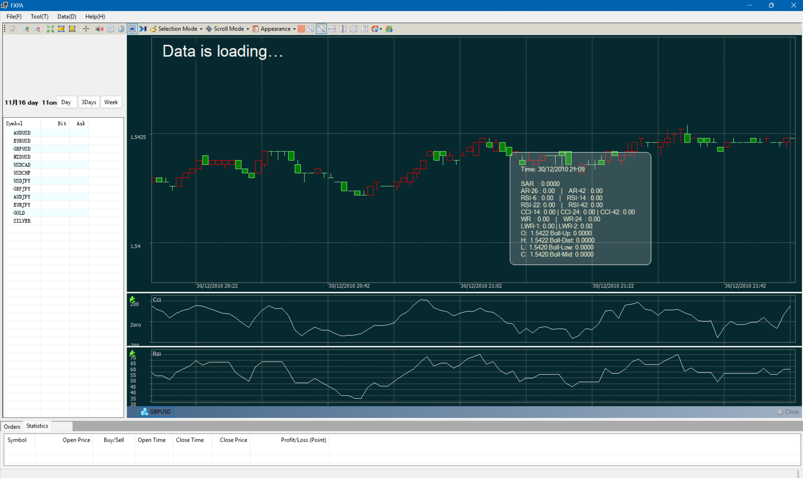

# FXPA — fx-trading-dotnet

*Revived from the 2008 fx-trading-platform-prototype archive, rebuilt on .NET 10.*

A foreign-exchange charting and technical-analysis desktop application for
Windows, built with **WinForms on .NET 10**. This repository carries FXPA
forward on the .NET desktop stack, tracking new .NET versions for as long as
Microsoft supports WinForms.

> **Lineage.** FXPA began life as
> [**fx-trading-platform-prototype**](https://github.com/harryho/fx-trading-platform-prototype)
> — a 2008 prototype built on WinForms and .NET Framework 3.5, which is now
> **archived**. This repository is FXPA **revived** from that archive: the same
> codebase ported in-place to **.NET 10** with behaviour preserved, then
> progressively modernized. A separate cross-platform application (Avalonia)
> is planned as a future repository; this one stays Windows-desktop-first.
>
> **No account, no server, no telemetry.** FXPA runs entirely offline against
> the bundled historical data — there is nothing to sign up for and nothing
> phones home.



## Features

- Multi-symbol forex charting (candles, zoom/pan, panes)
- Full TA-Lib indicator catalog (95+ indicators: RSI, Bollinger Bands, ADX,
  MACD, ATR, Stochastic, …) via the bundled `TA-Lib-Core` assembly
- FXPA-specific and custom indicators layered on top
- Session-based analysis workspace, orders/statistics panels
- Offline simulation data provider (no live server required)

## Getting started

Prerequisites: **Windows 10+** and the [.NET 10 SDK](https://dotnet.microsoft.com/download/dotnet/10.0).

> If you keep several SDKs side by side (e.g. via scoop), make sure the .NET 10
> one is active before building — plain `dotnet build` fails with NETSDK1045
> when the selected SDK is older. Idle build servers can block switching; run
> `dotnet build-server shutdown` first if a switch complains.

```powershell
git clone https://github.com/harryho/fx-trading-dotnet.git
cd fx-trading-dotnet
dotnet build src\fxpa\fxpa.csproj -c Release
dotnet run --project src\fxpa\fxpa.csproj
```

Or produce a self-contained executable (no runtime install needed on the
target machine):

```powershell
dotnet publish src\fxpa\fxpa.csproj -c Release -r win-x64 --self-contained
```

### Run the tests

```powershell
dotnet test fx-trading-dotnet.sln -c Release
```

## Repository layout

| Path | Purpose |
|---|---|
| `src/fxpa/` | The application (WinForms, single project) |
| `src/fxpa/fxd/` | Bundled historical data used by the simulation provider |
| `src/lib/` | Pre-built native/legacy dependencies (TA-Lib) |
| `tests/` | Test projects (characterization + golden-master tests) |
| `.github/workflows/` | CI: build, test, publish on Windows runners — manual trigger only |

## Engineering roadmap

The codebase is being uplifted in deliberate phases (tracking in this order):

1. **Seams + characterization tests** — lock current behaviour with
   golden-master tests around the indicator math before refactoring anything.
2. **Diagnostics** — leveled logging, no silent catches, exceptions never
   shut the log down.
3. **Threading discipline** — one rule: only the UI thread touches controls;
   provider threads marshal. Remove `lock(this)` in favour of private locks.
4. **Structure** — decompose the large chart/data classes; formalize the
   indicator plug-in surface.
5. **Pipeline** — analyzers gating new code, packaged release artifacts.
   (The CI workflow exists and can be run on demand from the Actions tab;
   it is deliberately not wired to push events, to conserve hosted-runner
   minutes. Local `dotnet test` covers the same suite.)

See the commit history for progress against these phases.

## License

This project is licensed under the [MIT License](LICENSE) — Copyright (c)
2005-2026 Harry Ho.

Third-party components redistributed with this project (TA-Lib, the Blowfish
implementations, SharpZipLib) keep their own licenses and are documented in
[THIRD-PARTY-NOTICES.md](THIRD-PARTY-NOTICES.md).
